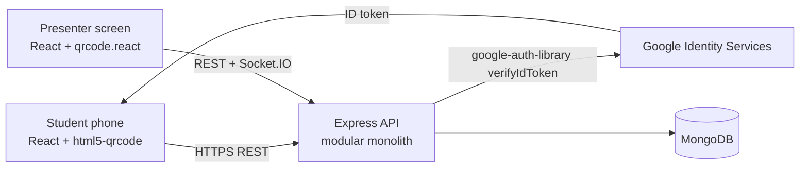
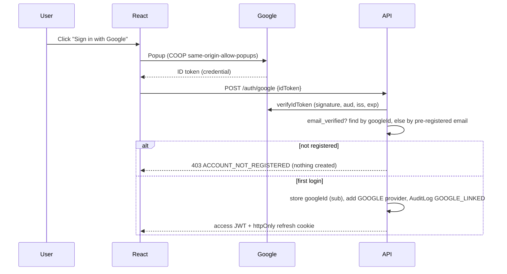
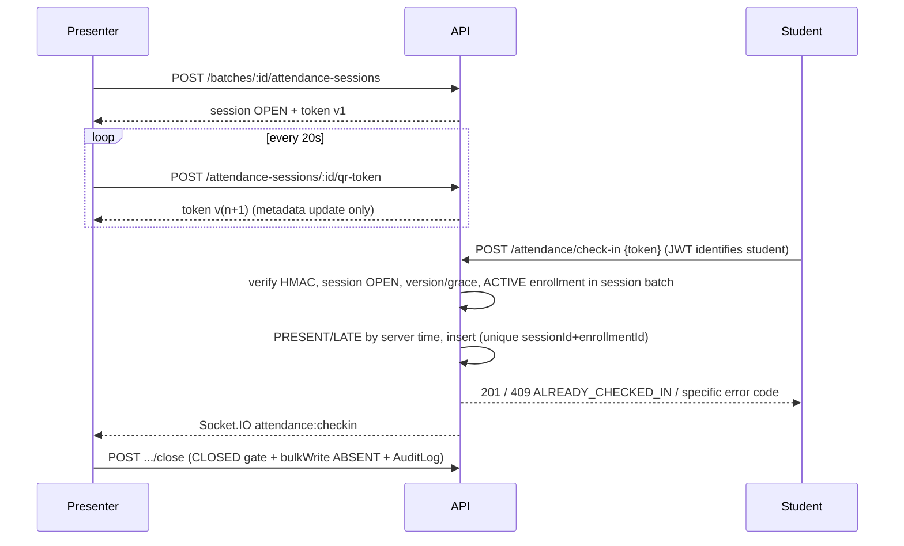
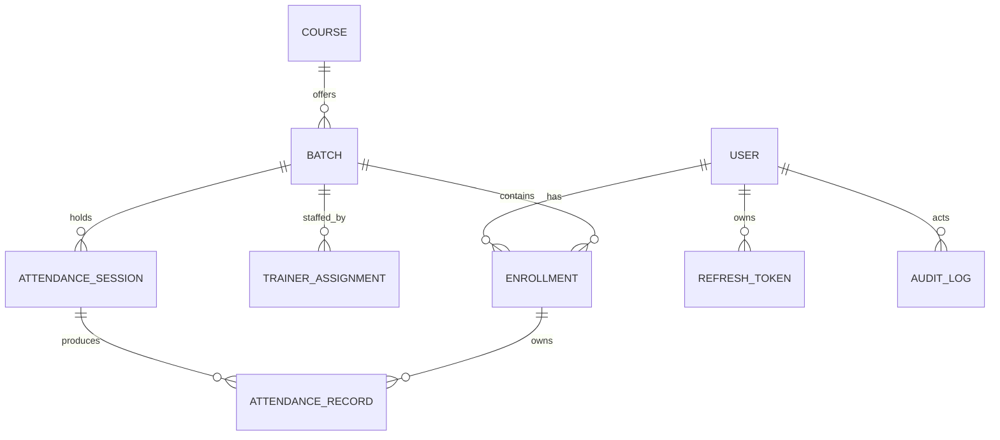

# Architecture, QR design and threat model

## System

## Google sign-in and account linking

## QR check-in

## Data model (MongoDB)

Key indexes: `User.email` unique, `User.googleId` unique sparse, `AttendanceRecord{sessionId,enrollmentId}` unique, `Enrollment{batchId,studentId}` unique where `status=ACTIVE`, `AttendanceSession{batchId}` unique where `status=OPEN`.

## QR token trade-offs
| | Stateless signed (implemented) | Stateful server tokens |
|---|---|---|
| DB load per scan | one session read | token lookup + possible writes per rotation |
| Revocation | close/cancel session or bump version | delete token |
| Grace window | version N-1 for `QR_GRACE_SECONDS` | keep previous row until TTL |
| Replay | bounded by R+G seconds | same, plus single-use possible |
Token = `ASDC1.<sessionId>.<version>.<HMAC-SHA256>`; contains no personal data. Version N is valid for R+G seconds after its rotation (also if the presenter stops rotating); N-1 only for G seconds.

## RBAC matrix (server-enforced)
| Capability | Super Admin | Admin | Trainer (assigned) | Student |
|---|---|---|---|---|
| Users / courses / batches / enrollments | yes (admins only SA) | yes (no admin creation) | read assigned batches | - |
| Start / rotate / close session | yes | yes | only with `canManageSessions` | - |
| View session records / reports | all | all | assigned only | - |
| Manual correction | yes | yes | no | no |
| Check in / own history | - | - | - | own only |
| Audit logs / export | yes | yes | no | no |

## Threat model highlights
Proxy attendance via shared logins (identity only from JWT, SSO, refresh rotation), QR relay (short TTL; cannot be fully prevented - use headcount reconciliation), token forgery (HMAC), duplicate/concurrent scans (unique index + E11000 -> 409), IDOR (batch scope checks in services), NoSQL injection (sanitise + zod strict schemas), brute force (rate limits), CSV formula injection (cell escaping), refresh theft (rotation + family revocation), clickjacking/XSS (helmet; no tokens in localStorage - access token in memory only).
No GPS or biometrics are collected. Optional IP-subnet anomaly flags would need your approval (privacy impact).
